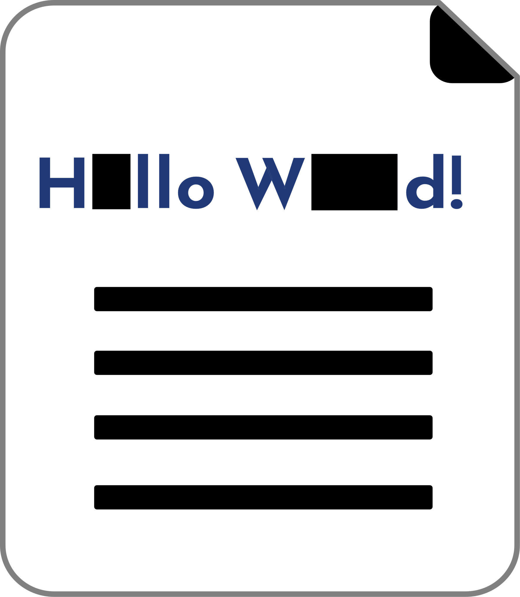

# &nbsp;&nbsp;DocuCloak

A web app that runs on your Mac and redacts PDFs and images. Point it at an input directory, give it a list of terms or turn on automatic PII detection, and it writes blacked-out copies of every matching file to an output directory. Your originals are never modified.

## Features

- Recursively scans the input directory for `.pdf`, `.jpg`/`.jpeg`, `.png`, `.tif`/`.tiff` and `.bmp` files
- **PDFs:** matched page text is removed from the file, not just covered, and a black box is drawn in its place (PyMuPDF)
- **Scanned PDFs:** pages without a text layer are read with Tesseract OCR, and the image pixels under each match are blacked out
- **Images:** text is read with Tesseract OCR and matches are covered with black boxes
- **Hidden PDF content:** every redacted PDF copy has its document properties (title, author and so on, including XMP metadata) and bookmarks removed, and is rewritten so removed content can't be recovered from the file. A term or detected value found only in those places still produces a cleaned copy
- Case-insensitive matching; a term also matches inside longer words (`secret` matches `secret123`). Multi-word terms like `Alice Smith` work in PDFs, scans and images
- Terms come from a text field, a terms file, or both. The terms file is re-read from disk on every run, so you can edit it and run again
- **Automatic PII detection (optional):** find email addresses, credit card numbers, US Social Security numbers and US phone numbers without listing each value. Email, cards and SSNs are on by default; phone detection is off because plain 10-digit numbers are ambiguous. Detected values use the same search-and-redact path as your terms, and only per-type counts are shown or logged-never the values themselves
- Copies are written as `<name>_redacted.<ext>` in the output directory, in the same subfolders as in the input directory (so same-named files in different folders never collide). The output directory is created if it doesn't exist
- Files with no matches are skipped: no copy is written. If a file no longer matches after you change the terms, its old `_redacted` copy is deleted, so the output directory always reflects the latest terms
- Live progress: which file(s) are being redacted right now, what was found (PDFs, scanned PDFs, images), how many files are done, elapsed time and an estimate of the time left, a progress bar, and each file's result in plain language. Cancel stops the current job
- Show files: click a file in the results to see it in Finder (File Explorer on Windows): the redacted copy, or the original if nothing was saved. **Show output folder** opens the output directory
- Password-protected PDFs, unreadable files and files that crash the PDF library are reported as errors without stopping the rest of the job
- Remembers the directories and terms file location between visits; the terms themselves are never saved
- Detailed log in `server.log`: UI actions, each file's outcome, and the number of terms used (never the terms themselves). It rotates at 5 MB, keeping the 3 most recent old logs (`server.log.1` to `server.log.3`)
- Only reachable from your own Mac: the server doesn't accept connections from other devices on your network

## Automatic PII detection

The **Also find automatically** row adds these detectors to a run. Use them with your own terms, or with none at all:

| Type | What it accepts | Default |
| --- | --- | --- |
| Email address | `name@example.com`, including `+` tags and subdomains | On |
| Credit card number | 13-19 digits, with or without spaces or hyphens. Requires a Luhn checksum and a major issuer prefix (or a nearby card label). A grouped number with a known issuer is accepted despite a failed checksum only when a card label is nearby. A number introduced as an account, invoice, reference or similar identifier is not treated as a card | On |
| US Social Security number | The `123-45-6789` (or space-separated) shape. A bare 9-digit number is only treated as an SSN when `SSN`, `Social Security` or `Taxpayer ID` appears next to it and the SSA range rules pass | On |
| US phone number | 10 digits, with optional `1`/`+1`, parentheses, dots, spaces or hyphens, and an optional extension. The area code must start with 2-9 | Off |

Digit count separates the ambiguous cases: an SSN is 9 digits and a US phone is 10, so a hyphenless `123456789` is never treated as a phone, while a hyphenless `5551234567` is checked only when phone detection is on.

Counts are occurrences, not unique values: if the same number appears on every page, it is counted each time.

Detection runs on PDF text and on the OCR text from scanned pages and images, so it works the same way as your terms. It is best-effort and US-centric. It does not find names, addresses, dates of birth or account/passport numbers; add those as terms. See the limitations below.

---


---

## Performance

DocuCloak uses every CPU core. Each job runs in three steps:

1. **Survey.** Every file is classified (text PDF, scanned PDF, mixed, image, password-protected) and its work estimated. This takes a fraction of a second, even for hundreds of files.
2. **Split.** Each scanned page becomes its own task and large text PDFs are searched in 25-page chunks, so no single big file holds up the job. Small files stay whole.
3. **Schedule.** Tasks run in worker processes, one per core, largest first, so the job never ends with one big file running alone. One worker serves the smallest files first, so results start appearing within a second.

On a 12-core Mac, a mixed folder of 48 files (30 text PDFs, 7 scanned or partly scanned PDFs, 10 photos and a password-protected PDF; 566 PDF pages) takes about 11 seconds, compared with about 60 seconds before. OCR is most of the work: a scanned page or photo takes about a second, a text page a few hundredths of a second.

The time-left estimate replays the remaining work on the available workers, calibrated as tasks finish to how fast this machine actually is. On the folders above it was typically within a second of the real time left; the first estimate appears within a second or two of starting.

Worker processes stop 2 minutes after the last job to give their memory back, and start again with the next job. To use fewer cores, set `WORKERS` in `app.conf`.

## Requirements

- macOS (DocuCloak is plain Python with its own in-page file browser, so it may also run on Windows and Linux, but only macOS is tested)
- Python 3.10+
- [Tesseract](https://github.com/tesseract-ocr/tesseract), needed for images and scanned PDFs: `brew install tesseract`. A badge in the top-right corner of the app shows whether it was found; if not, a help window explains how to install it, and scanned PDFs and images are reported as **error** (never as skipped) while regular PDFs are still redacted. DocuCloak looks on your PATH and in `/opt/homebrew/bin` and `/usr/local/bin`, and checks again each time the page loads, so there's no need to restart after installing

On first run, DocuCloak installs PyMuPDF, Pillow and pytesseract if they're missing. To install the exact versions the app is tested with:

```bash
pip install -r requirements.txt
```

## Running

```bash
./server.sh start      # start in the background and open http://localhost:5903
./server.sh stop
./server.sh restart
./server.sh status
./server.sh logs       # follow server.log
```

Or double-click `docucloak.command` in Finder (press Return in its Terminal window to stop), or run `python3 app.py` in the foreground (Ctrl+C to stop).

If macOS says it "could not verify `docucloak.command` is free of malware", the folder arrived by AirDrop or a downloaded ZIP, which macOS marks as quarantined (a `git clone` doesn't). The launcher is a short, readable shell script; to allow it, run this in the DocuCloak folder:

```bash
xattr -dr com.apple.quarantine .
```

Or click **Open Anyway** in System Settings > Privacy & Security after the warning, or start DocuCloak with `./server.sh start` instead.

After you update DocuCloak's files (for example by copying in a newer version), `./server.sh start` and `docucloak.command` notice the change and restart the server. If the page says DocuCloak "is still running the old version", run `./server.sh restart` and reload the page.

To change the port, edit `PORT` in `app.conf`.

## Usage

1. Set the **Input directory** and the **Output directory**. Type a path or click **Browse** to pick a folder in DocuCloak's file browser, which opens at the folder currently in the field (or your home folder if that folder doesn't exist) and has shortcuts to Home, Desktop, Documents and Downloads. The output directory must be a different folder from the input directory; it may be inside it, and files already in it are never scanned.
2. Enter terms in the text field (comma or newline separated), and/or click **Choose File** to pick a terms file in the same format. Optionally choose what to find under **Also find automatically**.
3. Click **Start Redaction**, then check the results list: each file shows **redacted** (with its output name and any automatic PII counts), **skipped: no matches**, or **error** with the reason. At least one term or one detector is required.

If no terms are given and a `redact_terms.txt` file exists in the DocuCloak folder, its terms are used instead.

## Known limitations

Check redacted output before sharing it.

- **Automatic detection is best-effort.** It is tuned for high precision, but no detector is perfect and it only knows the formats described above. Review the redacted copy.
- **Account, invoice and reference numbers are not cards.** A number introduced by one of those labels is left for your terms even when it is 13-19 digits, unless a card label such as `Card` or `Visa` is next to it.
- **A few unlabelled account numbers can still look like cards.** If a card-shaped number has no account label and happens to pass the card checksum, it can be detected. Check the counts if your documents contain many long account numbers.
- **Phone detection is noisy.** Any 10-digit number (an order, account or ticket number) can look like a US phone. Leave it off unless your documents contain phone numbers.
- **Bare 9-digit SSNs need a label.** Without `SSN`, `Social Security` or `Taxpayer ID` nearby, a 9-digit number is left alone because ZIP+4s, EINs and invoice numbers share its shape. Separated SSNs are redacted by shape.
- **Only US phone numbers are recognized.** International numbers and unusual extension formats are not detected.
- **Detection does not find names or addresses.** Those still need to be entered as terms.
- **OCR can miss text.** Scanned pages and images are only as good as Tesseract's reading of them: faint, skewed, low-resolution or handwritten text may not be recognized, and only English is installed by default.
- **Images inside text pages are not OCR'd.** OCR runs on PDF pages with no text layer; on a page that has text, an embedded image (such as a scanned signature or stamp) is not searched.
- **Other hidden PDF content is not searched.** Comments and other annotations, form field values and file attachments are not checked for terms.
- **Password-protected PDFs are not redacted.** They are reported as errors; remove the password first.


## Tests

```bash
pip install pytest playwright   # playwright is optional: it runs the UI tests in your installed Google Chrome
python3 -m pytest
python3 -m pytest -m 'not browser'   # skip the Chrome UI tests
```

Tests build their own sample files in temporary directories and never touch your documents. Without Chrome the UI tests are skipped, and without Tesseract the real-OCR test is skipped.

## License

MIT
